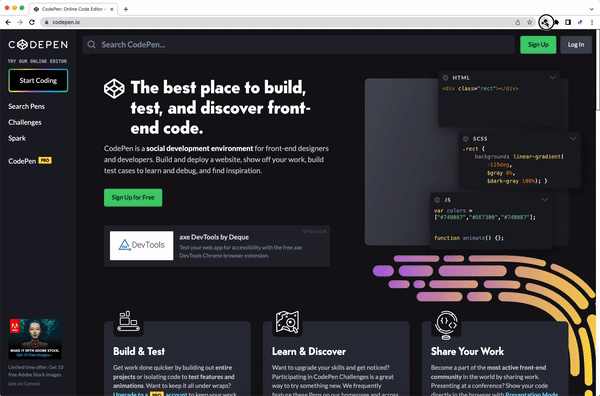

# E-ink Viewable

A chrome extension to make all websites viewable in e-ink screen, convert dark theme to light theme automatically.

## Modes

The popup has one switch for the current site (changes apply immediately):

- **Comfort (Auto, default)** — the per-node conversion engine described below. Keeps the site's own look as far as possible.
- **High contrast (Contrast)** — converts source styles to black and white while preserving local visual differences between selected controls and their peers. Foreground, background, nested badges, icons and pseudo-elements are planned together. Small selected controls can use black fill with white text; large selected regions use an edge. Keyboard focus remains visible independently. Source styles are sampled without the extension’s own paint, so switching controls removes old selection backgrounds. Ordinary glass, filtered and blended surfaces convert normally. Photos and complex SVG content retain their source paint.
- **Off** — the site's own look.

The gear icon in the popup sets the **default mode** for sites without their own choice. The top switch turns the extension **on or off everywhere at once** — for reading on regular monitors (#4) — and a `toggle-enabled` keyboard command (no default key; configure at `chrome://extensions/shortcuts`) flips the same switch. The keyboard shortcut (`Ctrl+Shift+X` by default) flips the current site between off and its last mode.

## Languages

Seventeen: English, 简体中文, 繁體中文, 日本語, 한국어, Español, Português (Brasil), Français, Deutsch, Italiano, Русский, العربية, हिन्दी, Bahasa Indonesia, Tiếng Việt, ไทย, Türkçe. The popup's settings panel (gear icon) has a language dropdown — by default it follows the browser's language (`src/_locales/`); Arabic flips the popup to right-to-left. Adding a language = dropping a `messages.json` into a new locale folder plus one `<option>` in `popup.html`.

## How it works

- **Zero footprint when disabled.** On sites whose effective mode is Off, the extension adds no CSS at all.
- **Comfort changes only colors that break on white.** Dark backgrounds become white; near-white text, borders and svg fills become black. Links, accent colors and mid grays keep the page's own color, so a page that is already light stays essentially untouched. All modern CSS color formats are understood (`oklch()`, `oklab()`, `lab()`, `color()`, `hsl()` — the ones Tailwind v4 and friends emit), and dark `:hover` / `:focus` styles are flipped the moment they appear — then once more after the site's own color transition settles, so animated hover colors can't stay invisible. Form state (`input:checked` tab groups) and class changes (theme toggles) re-plan the affected nodes through the same batched pipeline, and a re-plan only writes values that actually changed. Text that sits on a photo (banner images and the like) keeps the color the site chose for it — only opaque dark backgrounds are rewritten. `::before` / `::after` decorations are converted too, and gradient-clipped text (`background-clip: text`) is treated as text paint, not background.
- **Batched updates.** Both modes schedule conversion through animation frames. High contrast skips redundant paint, plans local changes with their dependency region, and groups identical output into shared CSS rules. Source sampling, planning and necessary node updates yield between batches. Ordinary content changes and added subtrees do not resample unrelated content. Periodic checks rotate through at most 192 nodes per tick for changes without DOM events. Stable pages reduce source sampling to alternate ticks; native state and late shadow checks remain independent. Sampling temporarily releases only related paint rules. It enters open shadow roots and restores author inline values when stopped.

Known limits: Comfort does not observe arbitrary inline style updates or enter shadow roots. High contrast cannot enter closed shadow roots or inspect pixels inside canvas, video and images. Changes without DOM or interaction signals require a bounded periodic pass, whose duration grows with page size; source sampling can take two ticks per batch after idle backoff. Groups with more than four source appearances use explicit selected state instead of guessing additional color meanings. Custom elements with inline important paint are left untouched to avoid reentrant style callbacks; transparent custom controls that rely on a dark ancestor can still need refinement.

## Install from Chrome Web Store

https://chrome.google.com/webstore/detail/e-ink-viewable/lfeckmgmmnioloncabbkcddnnooofdmg

## Install from source code

1. Open `chrome://extensions/` in Chrome.
2. Enable `Developer mode`.
3. Click `Load unpacked` button and choose the `src` folder.

## Architecture

Policy modules stay independent of `chrome.*`. Node tests exercise policy decisions, DOM state changes, restoration and work counts:

- `src/color.js` — color math: parsing every CSS color format and deciding which colors to flip.
- `src/engine.js` — the conversion engine: skip rules, effective-background resolution, batching, mutation and hover handling. Computed styles and frame scheduling are injected; `inject.js` is its thin glue.
- `src/contrast.js` — pure source-style grouping and coordinated black-and-white paint policy.
- `src/contrast-dom.js` — source sampling, shared rule output, document/shadow observers and reconciliation queues.
- `src/contrast-inline.js` — reversible handling of author inline important paint.
- `src/contrast-output.js` — inheritance-safe removal of redundant paint.
- `src/toggle.js` — per-site mode, global default and shortcut state on top of injected storage, plus one-time migration from the pre-1.4 pause flags.
- `src/popup-ui.js` — every popup label and click behavior, on injected elements/service.

`src/inject.js`, `src/background.js` and `src/popup.js` contain only `chrome.*` wiring.

## Development

```
node --test tests/*.test.js
node tools/check-contrast-regressions.js
node tools/check-contrast-performance.js
node tools/compare-contrast-engines.js
```

Serve the repository root with a local HTTP server and open `tests/browser/contrast.html` for real-browser interaction checks. Add `?large=1000` to exercise shared rules and queue progress with 1,000 extra controls. `tests/browser/policy.html` checks actual filters, blending, animations, multicolor controls and media boundaries. `tests/browser/sites.html` replays captured source styles from 20 public websites with neutral text and media placeholders. The pinned corpus also runs in the Node suite; media exemptions are checked against source facts, ordinary text must use white surfaces and black glyphs, and selected cues must differ from their peers. These are offline replays, not live-site extension certification.

`tests/browser/performance.html?size=10000` measures actual animation-frame work on already black-and-white content; add `&paint=gray` to require conversion of every article row. It records source reads, output and sampling writes, maximum callback time, and CSSOM convergence using a newly added outline. Performance unit tests assert work counts and affected regions rather than elapsed time. The regression tool first runs the unchanged current suite, then introduces known faults in temporary copies and requires their specific assertions to fail.

## More from the author

[PlainApp](https://plainapp.app) — an open-source Android app that lets you securely manage your phone (files, media, contacts, SMS, calls) from a web browser. Also on [Google Play](https://play.google.com/store/apps/details?id=com.ismartcoding.plain).

## Samples




